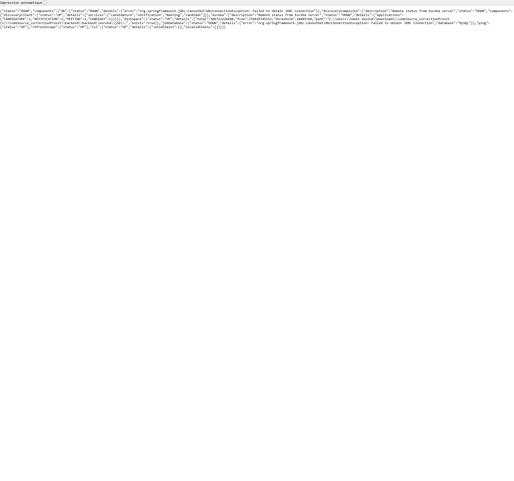
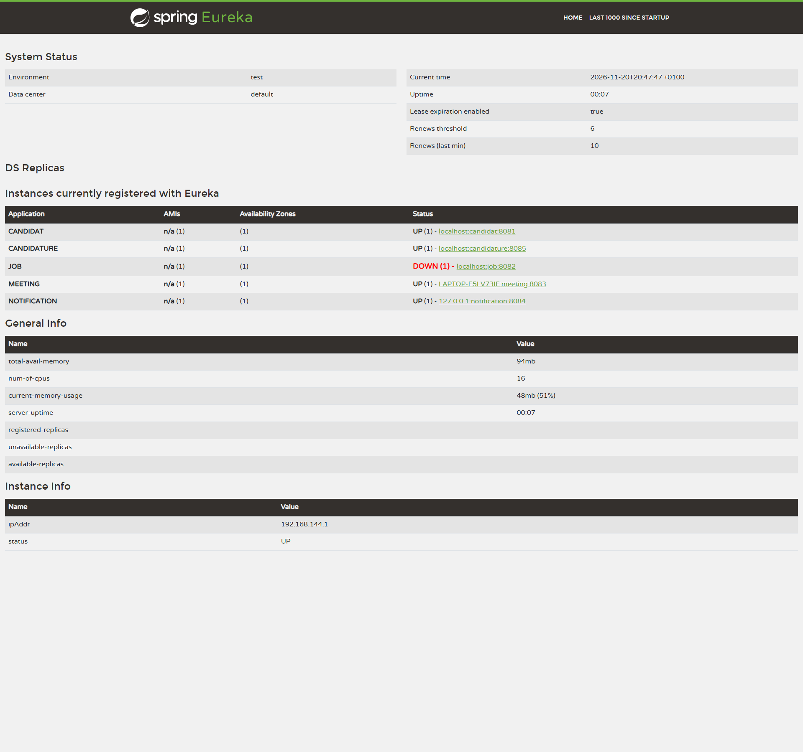
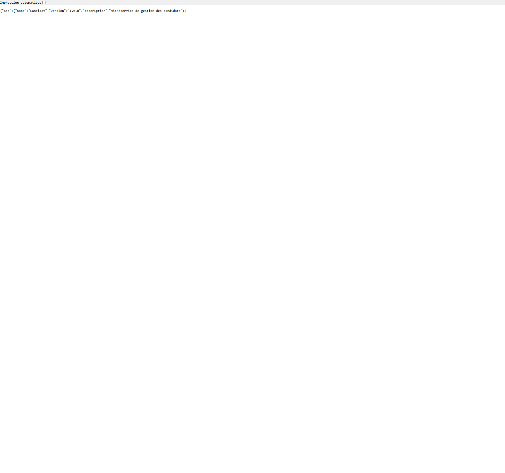
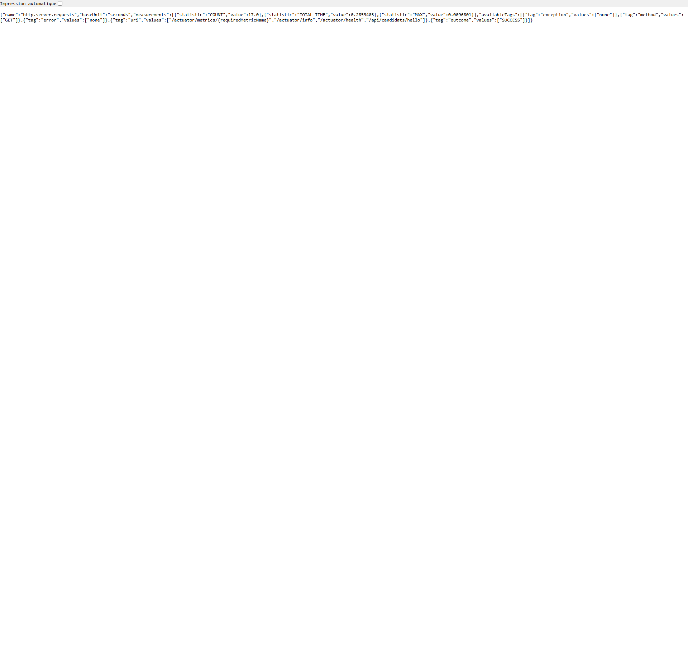
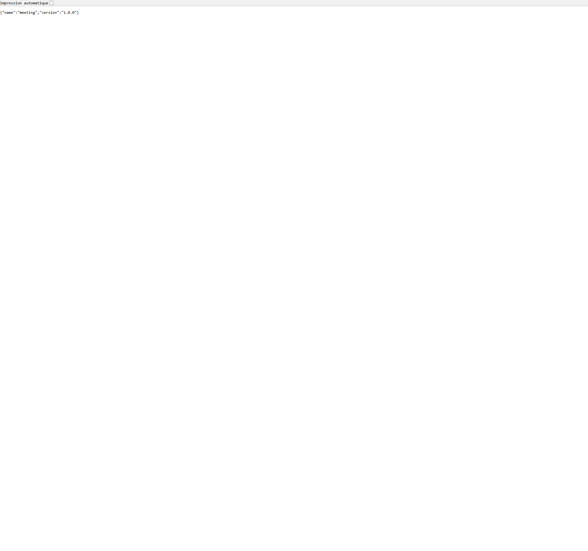

# Atelier Eureka et Actuator

Projet Maven multi-module contenant le serveur Eureka et les microservices demandes dans l'atelier.

## Membres de l'equipe

Remplacer les lignes avant le rendu :

- Nom Prenom
- Nom Prenom

La valeur `info.app.team` de Candidat peut etre renseignee avec la variable `APP_TEAM`.

## Services et ports

| Service | Technologie | Port | Base | Nom Eureka |
| --- | --- | ---: | --- | --- |
| Eureka Server | Spring Boot | 8761 | - | - |
| Candidat | Spring Boot / H2 | 8081 | H2 memoire | CANDIDAT |
| Job | Spring Boot / MySQL | 8082 | MySQL | JOB |
| Meeting | Node.js / Express | 8083 | - | MEETING |
| Notification | Python / FastAPI | 8084 | - | NOTIFICATION |
| Candidature | Spring Boot / MySQL | 8085 | MySQL | CANDIDATURE |

## Demarrage

Demarrer MySQL dans XAMPP ou WAMP, puis Eureka Server, puis les microservices. Garder chaque application en execution pour qu'elle continue d'envoyer ses heartbeats a Eureka.

### Applications Java dans IntelliJ IDEA

Ouvrir ce dossier comme projet Maven et recharger tous les projets Maven. Choisir ensuite l'une des configurations partagees dans `.run/` : `Eureka Server`, `Candidat`, `Job` ou `Candidature`.

Pour lancer depuis des terminaux PowerShell separes a la racine du projet :

```powershell
.\mvnw.cmd -pl eureka-server spring-boot:run
.\mvnw.cmd -pl candidat spring-boot:run
.\mvnw.cmd -pl job spring-boot:run
.\mvnw.cmd -pl candidature spring-boot:run
```

MySQL est attendu sur `localhost:3306`, utilisateur `root`, mot de passe vide par defaut. Les bases `job_db` et `candidature_db` sont creees si le compte MySQL l'autorise. Les parametres sont surchargeables avec `JOB_DB_URL`, `JOB_DB_USERNAME`, `JOB_DB_PASSWORD`, `CANDIDATURE_DB_URL`, `CANDIDATURE_DB_USERNAME` et `CANDIDATURE_DB_PASSWORD`.

### Meeting (Node.js / Express)

Installer Node.js, puis lancer depuis le dossier `meeting` :

```powershell
npm install
npm start
```

Le service expose `GET /health` et `GET /info`. Les URLs `/health` et `/info` sont publiees dans son instance Eureka.

### Notification (Python / FastAPI)

Installer Python 3.12 ou plus recent, puis lancer depuis le dossier `notification` :

```powershell
python -m venv .venv
.\.venv\Scripts\Activate.ps1
pip install -r requirements.txt
python -m uvicorn main:app --host 0.0.0.0 --port 8084
```

Le service expose `GET /health` et `GET /info`. Son instance declare ces deux URL dans le registre Eureka.

## Verification Actuator et Eureka

Les liens ci-dessous sont cliquables lorsque les services correspondants sont demarres :

| Service | Tableau / informations | Sante | Metriques |
| --- | --- | --- | --- |
| Eureka | [Tableau de bord](http://localhost:8761) · [Registre JSON](http://localhost:8761/eureka/apps) | - | - |
| Candidat | [Info](http://localhost:8081/actuator/info) | [Health](http://localhost:8081/actuator/health) | [Metrics](http://localhost:8081/actuator/metrics) |
| Job | [Info](http://localhost:8082/actuator/info) | [Health](http://localhost:8082/actuator/health) | [Metrics](http://localhost:8082/actuator/metrics) |
| Candidature | [Info](http://localhost:8085/actuator/info) | [Health](http://localhost:8085/actuator/health) | [Metrics](http://localhost:8085/actuator/metrics) |
| Meeting | [Info](http://localhost:8083/info) | [Health](http://localhost:8083/health) | - |
| Notification | [Info](http://localhost:8084/info) | [Health](http://localhost:8084/health) | - |

Liens supplementaires pour l'atelier : [logs de Job](http://localhost:8082/actuator/loggers/org.example.job.JobController), [appel de test Job](http://localhost:8082/api/jobs/hello), [appel de test Candidat](http://localhost:8081/api/candidats/hello), [metriques HTTP Candidat](http://localhost:8081/actuator/metrics/http.server.requests?tag=status:200).

### Tester la panne MySQL de Job

1. Ouvrir <http://localhost:8082/actuator/health> et verifier que le statut est `UP`.
2. Arreter MySQL dans XAMPP/WAMP.
3. Recharger la page de sante : le composant de base de donnees, le `JobDatabaseHealthIndicator`, puis le statut global doivent passer `DOWN`.
4. Verifier le statut `JOB` dans Eureka, puis redemarrer MySQL et constater le retour a `UP`.

### Modifier le niveau des logs sans redemarrer

L'endpoint `/actuator/loggers` est expose sur les trois applications Java. Exemple PowerShell pour activer `DEBUG` sur le controleur Job :

```powershell
Invoke-RestMethod -Method Post -Uri http://localhost:8082/actuator/loggers/org.example.job.JobController -ContentType 'application/json' -Body '{"configuredLevel":"DEBUG"}'
```

Pour lire le niveau courant, ouvrir <http://localhost:8082/actuator/loggers/org.example.job.JobController>, puis appeler <http://localhost:8082/api/jobs/hello> et observer le journal IntelliJ.

### Lire les metriques HTTP

Appeler plusieurs fois <http://localhost:8081/api/candidats/hello>, puis ouvrir :

- <http://localhost:8081/actuator/metrics/http.server.requests>
- <http://localhost:8081/actuator/metrics/http.server.requests?tag=status:200>

La mesure `COUNT` donne le nombre de requetes observees et `MAX` la duree maximale. Dans la capture de cet exemple, le filtre `status:200` donne COUNT `15` et MAX `0.0096801` seconde; sans filtre, COUNT `21` et MAX `0.0096801` seconde. Ces valeurs changent avec le trafic.

## Bannière rouge d'Eureka en local

Le seuil de renouvellement est fixe a 50 % pour cet atelier local et recalcule chaque minute. Cela conserve la protection Eureka, tout en evitant que quelques secondes de decalage entre heartbeats declenchent un faux avertissement avec les instances de demonstration. Apres une modification de configuration du serveur, le redemarrer et actualiser le tableau.

## Captures pour le rendu

### Tableau Eureka : cinq services UP, sans alerte rouge


### Sante de Job : UP et indisponibilite MySQL simulee

La seconde capture de Eureka montre Job en `DOWN` alors que les quatre autres services restent `UP`. La sante renvoie HTTP 503 avec `db` et `jobDatabase` en `DOWN`. La simulation a utilise une URL MySQL inaccessible uniquement pour Job; MySQL n'a pas ete arrete pour ne pas interrompre Candidature.






### Actuator et services d'equipe








Les noms des membres dans la section « Membres de l'equipe » restent a remplacer avant le depot GitHub.
